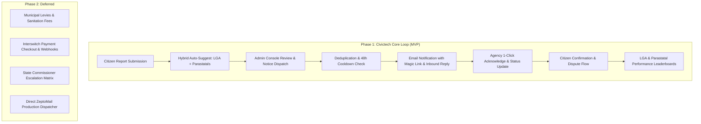

# CityPulse: Production Readiness Audit & Architectural Blueprint

## Executive Summary

**CityPulse** is a civic infrastructure intelligence platform that empowers citizens to report societal challenges and public infrastructure issues, tags the responsible government parastatals (e.g., LAWMA, PHCN/DisCos, NAFDAC) and Local Government Areas (LGAs), dispatches official notices, tracks institutional response, and ranks performance via transparent civic scorecards.

---

## 1. Production Readiness Audit (`/production-audit`)

### 1.1 Architecture & Stack Map
* **Frontend**: React 18, Vite, TypeScript, Tailwind CSS, shadcn/ui, TanStack Query, and Mapbox GL in [src/](file:///home/dot/hackathons/city-pulse/src).
  * **Citizen PWA Flow** at `/mobile` ([MobileHome.tsx](file:///home/dot/hackathons/city-pulse/src/pages/mobile/MobileHome.tsx), [MobileReport.tsx](file:///home/dot/hackathons/city-pulse/src/pages/mobile/MobileReport.tsx), [MobileLeaderboard.tsx](file:///home/dot/hackathons/city-pulse/src/pages/mobile/MobileLeaderboard.tsx)).
  * **Admin Console** at `/console` and `/` ([Issues.tsx](file:///home/dot/hackathons/city-pulse/src/pages/dashboard/Issues.tsx), [Dashboard.tsx](file:///home/dot/hackathons/city-pulse/src/pages/dashboard/Dashboard.tsx), [Analytics.tsx](file:///home/dot/hackathons/city-pulse/src/pages/dashboard/Analytics.tsx)).
* **Backend**: NestJS, Prisma ORM, PostgreSQL in [apps/api/](file:///home/dot/hackathons/city-pulse/apps/api).
  * Key Modules: [AuthModule](file:///home/dot/hackathons/city-pulse/apps/api/src/auth/auth.module.ts), [IssuesModule](file:///home/dot/hackathons/city-pulse/apps/api/src/issues/issues.module.ts), [LocationsModule](file:///home/dot/hackathons/city-pulse/apps/api/src/locations/locations.module.ts), [LeaderboardModule](file:///home/dot/hackathons/city-pulse/apps/api/src/leaderboard/leaderboard.module.ts), [AnalyticsModule](file:///home/dot/hackathons/city-pulse/apps/api/src/analytics/analytics.module.ts).

### 1.2 Current Gaps & Technical Findings

| Category | Finding | Impact & Risk | Required Action |
| :--- | :--- | :--- | :--- |
| **Civic Data Model** | Issues only store `lgaId` and `communityId` ([schema.prisma](file:///home/dot/hackathons/city-pulse/apps/api/prisma/schema.prisma)). | No way to assign or track parastatals like LAWMA, PHCN/DisCos, NAFDAC, or LASTMA. | Introduce `Agency`, `IssueAgencyTag`, and `AgencyResponse` models. |
| **Notification Engine** | No email delivery code exists in the backend. | Agencies cannot be alerted when issues occur in their jurisdiction. | Implement a pluggable `NotificationService` (Mock/Console logger in dev, ZeptoMail in prod). |
| **Anti-Spam / Deduplication** | Reports are submitted independently without cluster throttling. | Risk of inundating parastatals with duplicate emails for the same pothole, burst pipe, or outage. | Implement **Admin-Triggered Official Notice Dispatch** with 48h cluster cooldown warnings. |
| **Rankings & Scorecards** | Leaderboard currently only ranks residential communities. | LGAs and Parastatals cannot be held accountable or ranked by resolution performance. | Add **Balanced Civic Score** ranking for both LGAs and Parastatals. |
| **External Agency Access** | Updating issue status currently requires an authenticated Admin JWT. | Agencies will refuse to log into an external portal just to acknowledge a complaint. | Provide **Zero-Friction Magic Links** and **Inbound Email** response parsing. |
| **Deployment Discrepancy** | [apps/api/Dockerfile](file:///home/dot/hackathons/city-pulse/apps/api/Dockerfile) sets `ENV PORT=3008` on line 17, but `EXPOSE 3001` on line 24. | Container port forwarding failure depending on reverse proxy configuration. | Harmonize `PORT=3001` across Dockerfile, `.env.example`, and Vite proxy configs. |
| **In-Memory Cache Drift** | `IssuesListCacheService` stores cached lists in process memory (`Map`). | In multi-replica container environments, cache invalidations don't sync across instances. | Use HTTP caching headers or Redis for distributed invalidation. |
| **Scope Decoupling** | ~35% of schema and codebase is dedicated to payments and municipal levies. | Unnecessary complexity for the civic complaint & resolution lifecycle. | Decouple/deactivate payments for Phase 1 MVP. |

---

## 2. Target API Design (`/api-design`)

### 2.1 Prisma Schema Extension

```prisma
enum AgencyCategory {
  waste_management    // LAWMA
  power_electricity   // EKEDC, IKEDC (PHCN)
  roads_public_works  // LSPWC, FERMA
  water_drainage      // Lagos Water Corp, Drainage Dept
  traffic_transport   // LASTMA
  food_drug_safety    // NAFDAC
  emergency_safety    // LASEMA, Fire Service
  signage_advertising // LASAA
  building_control    // LASBCA
  general_civic
}

enum AgencyTicketStatus {
  notified
  acknowledged
  investigating
  in_progress
  resolved
  rejected
}

model Agency {
  id              String           @id @default(cuid())
  name            String           // e.g., "Lagos Waste Management Authority"
  acronym         String           @unique // e.g., "LAWMA"
  category        AgencyCategory
  officialEmail   String           @map("official_email")
  alternateEmail  String?          @map("alternate_email")
  phone           String?
  website         String?
  isStateAgency   Boolean          @default(true) @map("is_state_agency")
  isActive        Boolean          @default(true) @map("is_active")
  createdAt       DateTime         @default(now()) @map("created_at")
  updatedAt       DateTime         @updatedAt @map("updated_at")

  taggedIssues    IssueAgencyTag[]

  @@map("agencies")
}

model IssueAgencyTag {
  id                 String             @id @default(cuid())
  issueId            String             @map("issue_id")
  agencyId           String             @map("agency_id")
  status             AgencyTicketStatus @default(notified)
  trackingToken      String             @unique @map("tracking_token") // Secure Magic Token
  notificationSentAt DateTime?          @map("notification_sent_at")
  acknowledgedAt     DateTime?          @map("acknowledged_at")
  resolvedAt         DateTime?          @map("resolved_at")
  assignedByAdminId  String?            @map("assigned_by_admin_id")
  officialNotes      String?            @map("official_notes")
  resolutionProof    Json               @default("[]") @map("resolution_proof")
  createdAt          DateTime           @default(now()) @map("created_at")
  updatedAt          DateTime           @updatedAt @map("updated_at")

  issue              Issue              @relation(fields: [issueId], references: [id])
  agency             Agency             @relation(fields: [agencyId], references: [id])
  responses          AgencyResponse[]

  @@unique([issueId, agencyId])
  @@index([trackingToken])
  @@index([agencyId, status])
  @@map("issue_agency_tags")
}

model AgencyResponse {
  id             String         @id @default(cuid())
  ticketId       String         @map("ticket_id")
  responderName  String?        @map("responder_name")
  responderRole  String?        @map("responder_role")
  channel        String         @default("magic_link") // "magic_link" | "inbound_email" | "admin_logged"
  message        String
  etaDate        DateTime?      @map("eta_date")
  proofUrls      Json           @default("[]") @map("proof_urls")
  createdAt      DateTime       @default(now()) @map("created_at")

  ticket         IssueAgencyTag @relation(fields: [ticketId], references: [id])

  @@map("agency_responses")
}
```

---

### 2.2 Endpoints & Interactions

#### A. Agencies Catalog & Tagging
* `GET /api/v1/agencies`
  * Returns list of registered parastatals. Filterable by `?category=waste_management` or `?lgaId=...`.
* `POST /api/v1/issues/:id/tags`
  * Attach parastatal(s) to an issue (supports auto-suggested or manual tags).
* `POST /api/v1/issues/:id/dispatch-notice`
  * Triggers official email dispatch to the tagged Agency/LGA.
  * **Anti-Spam Verification**: Inspects past dispatches in the same community/LGA within 48 hours for similar issues. Returns cluster warnings if an alert was recently dispatched.

#### B. Zero-Friction External Response Interface
* `GET /api/v1/external/tickets/:trackingToken`
  * Publicly accessible with valid token (no password/login required).
  * Returns incident report details, location landmark, severity, photo evidence, and community validation count.
* `POST /api/v1/external/tickets/:trackingToken/acknowledge`
  * Agency marks ticket as acknowledged; records `acknowledgedAt` for speed scoring.
* `POST /api/v1/external/tickets/:trackingToken/respond`
  * Body: `{ message: string, status: "in_progress" | "resolved", etaDate?: string, proofUrls?: string[] }`
  * Updates ticket status and records official response.
* `POST /api/v1/external/inbound-mail/webhook`
  * Webhook listener for inbound email replies from agency mailboxes (e.g. `ticket-[token]@citypulse.ng`).

#### C. Performance Rankings & Scorecards
* `GET /api/v1/leaderboard/lgas`
  * Ranks Lagos LGAs by resolution performance.
* `GET /api/v1/leaderboard/agencies`
  * Ranks parastatals (e.g., LAWMA vs EKEDC vs LSPWC) by:
    * Total assigned issues
    * Average acknowledgment time (hours)
    * Resolution rate (%)
    * Citizen validation rate (penalized if citizens report issue is still broken)

$$\text{Balanced Civic Score} = (\text{Resolution Rate} \times 0.50) + (\text{Speed Factor} \times 0.30) + (\text{Citizen Validation} \times 0.20)$$

---

## 3. Seed Catalog for Lagos & Federal Civic Bodies

| Parastatal / Agency | Acronym | Category | Default Contact Target |
| :--- | :--- | :--- | :--- |
| Lagos Waste Management Authority | **LAWMA** | `waste_management` | Refuse dumps, blocked drainage waste, illegal dumping |
| Eko Electricity Distribution Company | **EKEDC** | `power_electricity` | Fallen power poles, transformer fires, wire hazards (Island/South) |
| Ikeja Electric Plc | **IKEDC** | `power_electricity` | Power outages, exposed cables, electrical hazards (Mainland/North) |
| Lagos State Public Works Corporation | **LSPWC** | `roads_public_works` | Potholes, road collapse, failed paving |
| Lagos State Traffic Management Authority | **LASTMA** | `traffic_transport` | Traffic light failures, abandoned vehicles blocking lanes |
| National Agency for Food and Drug Admin | **NAFDAC** | `food_drug_safety` | Contaminated water/food sales, illegal drug distribution |
| Lagos State Signage & Advertisement Agency | **LASAA** | `signage_advertising` | Dilapidated billboards, dangerous signage structures |
| Lagos State Building Control Agency | **LASBCA** | `building_control` | Distressed buildings, structural cracks, illegal construction |
| Lagos State Emergency Management Agency | **LASEMA** | `emergency_safety` | Fire hazards, building collapses, chemical spills |

---

## 4. MVP Scope Definition (`/mvp-scope`)



### Must-Haves (Phase 1 MVP)
1. **Agency Directory & Seeding**: Store official Lagos/Federal parastatals with category tags and official email contacts.
2. **Issue Tagging**: Auto-suggest responsible parastatals based on issue category with option to adjust.
3. **Admin-Controlled Notice Dispatch**: Admin reviews the issue and clicks "Dispatch Official Notice", with warnings if a similar issue was recently notified.
4. **Token-Based Response Portal**: Lightweight web page where agency representatives can view details, acknowledge with one click, or mark as resolved.
5. **Leaderboard & Ranking**: Public dashboard ranking both LGAs and Parastatals based on the Balanced Civic Score.

### Deferred (Phase 2)
1. **Payments & Levies**: Leaving out Interswitch checkout, sanitation levies, and payment receipt webhooks.
2. **Direct ZeptoMail Integration**: Use mock/console delivery for now; activate ZeptoMail credentials when going live.
